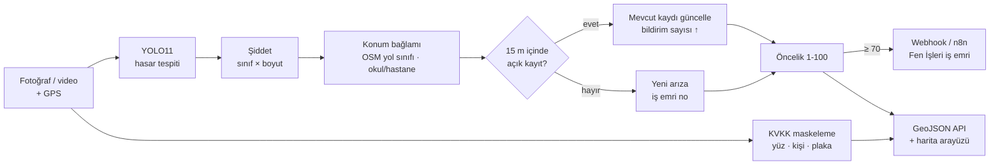

# Bursa Yol Hasarı Karar Destek Sistemi (PoC)

Saha araçlarından ve vatandaşlardan gelen yol fotoğraflarını **önceliklendirilmiş, CBS uyumlu iş emirlerine** dönüştüren uçtan uca bir prototip.



## Neler yapıyor?

| Katman | Ne yapıyor | Dosya |
|---|---|---|
| Hasar tespiti | RDD2022 ile eğitilmiş YOLO11: boyuna çatlak (D00), enine çatlak (D10), timsah sırtı (D20), çukur (D40) | `app/detector.py` |
| Şiddet ve öncelik | Hasarın kendisi (şiddet) ile ekibin önce nereye gideceği (öncelik) ayrı hesaplanır | `app/severity.py` |
| Konum bağlamı | Hasar ana arterde mi, ara sokakta mı? 150 m içinde okul/hastane var mı? (OpenStreetMap, çevrimdışı) | `app/context.py` |
| KVKK | Kişi, yüz ve plaka bölgeleri **diske yazılmadan önce** maskelenir; ham görüntü saklanmaz; saklama süresi dolan görseller silinir | `app/privacy.py` |
| Mükerrer kayıt | 15 m içindeki açık kayıtla birleştirir, yeni iş emri açmaz; konum her bildirimle ortalanır | `app/pipeline.py`, `app/repository.py` |
| İş emri | Kritik eşiği ilk kez aşan arıza için tek bir webhook (n8n vb.) | `app/notifier.py` |
| Video | Saha aracı videosunda ByteTrack takibi: her hasar bir kez gönderilir, GPS zamanla eşlenir | `scripts/process_video.py` |
| Arayüz | Leaflet haritası, fotoğraf yükleme, önceliğe göre iş kuyruğu, saha geri bildirimi | `app/static/index.html` |

## Öncelik formülü

```
Şiddet  S = max_i [ w_sınıf × (0.5 + 0.5 × boyut) ] + çoklu hasar katkısı (≤ 0.15)     0–1
Öncelik P = 100 × S × K_konum × B_bildirim                                              1–100

w_sınıf   : D40 1.0 · D20 0.8 · D10 0.5 · D00 0.4      (Fen İşleri ayarlayabilir: CLASS_WEIGHTS)
boyut     : kalibre araç kamerasında zemin alanı (m², homografi), diğerlerinde görüntü alan oranı
K_konum   : otoyol/devlet yolu 1.0 · ana arter 0.9 · tali 0.8 · toplayıcı 0.7 · ara sokak 0.55, okul/hastane yakını +0.1
B_bildirim: 1 + 0.25 × ln(bildirim sayısı)
```

Model güven skoru şiddete **katılmaz**; yalnızca eşik olarak kullanılır (`CONF_THRESHOLD`). Güven, modelin ne kadar emin olduğunu gösterir, hasarın ne kadar kötü olduğunu değil.

| Seviye | Puan | Önerilen aksiyon (Fen İşleri belirler) |
|---|---|---|
| Kritik | ≥ 70 | Otomatik iş emri |
| Yüksek | 45–69 | Haftalık plan |
| Orta | 25–44 | İzleme |
| Düşük | < 25 | Periyodik bakım |

## Hızlı başlangıç

### 1. Modeli eğitin (Google Colab)

1. Bu repoyu GitHub'a yükleyin.
2. [`notebooks/01_model_egitimi_colab.ipynb`](notebooks/01_model_egitimi_colab.ipynb) dosyasını Colab'da açın, T4 GPU seçin ve `REPO_URL` değerini düzenleyin.
3. Önce `QUICK=True` ile deneyin, sonra tam eğitimi başlatın.
4. Drive'daki `yol-hasar-tespit/best.pt` dosyasını bu projede `models/best.pt` konumuna koyun.

Notebook sunum için gereken grafikleri de üretir: sınıf dağılımı, eğitim eğrileri, karışıklık matrisi, test metrikleri, hata analizi ve örnek tahminler.

### 2. Docker ile çalıştırın

```bash
cp .env.example .env
docker compose up --build
```

Arayüz: http://localhost:8000 · API dokümantasyonu: http://localhost:8000/docs

### 3. Docker olmadan (geliştirme)

```bash
python -m venv .venv && source .venv/bin/activate
pip install -r requirements-dev.txt
python scripts/download_models.py
uvicorn app.main:app --reload
pytest
```

## API

| Uç nokta | Açıklama |
|---|---|
| `POST /api/analyze-road` | `image` (dosya), `lat`, `lon` (boşsa EXIF GPS), `source` (`vatandas` \| `saha_araci`) |
| `GET /api/issues?durum=acik&min_oncelik=45` | Arızalar, GeoJSON `FeatureCollection` (EPSG:4326), önceliğe göre sıralı |
| `GET /api/issues/{id}` | Arıza ve tüm bildirimleri |
| `PATCH /api/issues/{id}` | `{"durum": "ekip_yonlendirildi" \| "onarildi" \| "yanlis_tespit"}`: saha geri bildirimi |
| `GET /api/stats` | Durum ve seviye özetleri |
| `GET /health` | Model, KVKK dedektörleri, bağlam verisi, webhook durumu |

GeoJSON çıktısı Netcad, ArcGIS ve QGIS'e doğrudan katman olarak eklenebilir.

## Veri

| Veri | Kaynak | Lisans | Kullanım |
|---|---|---|---|
| RDD2022 (Çekya, Hindistan, Japonya, ABD, Çin) | [figshare](https://figshare.com/articles/dataset/21431547), Arya ve ark. 2022 | CC BY 4.0 | Eğitim / doğrulama / test |
| Bursa sokak görüntüleri | [Mapillary](https://www.mapillary.com), `scripts/fetch_mapillary_bursa.py` | CC BY-SA 4.0 | Bursa test seti (alan farkı ölçümü) |
| Bursa yol ağı, okul, hastane | OpenStreetMap, `scripts/fetch_osm_context.py` | ODbL | Konum katsayısı |

**RDD2022'de Türkiye verisi yoktur.** Bu nedenle model ayrıca Bursa görüntülerinden oluşan bir test setinde ölçülür (notebook bölüm 6).

### Bursa test seti oluşturma

```bash
export MAPILLARY_TOKEN="MLY|..."          # https://www.mapillary.com/dashboard/developers
python scripts/fetch_mapillary_bursa.py --per-cell 15
```

Görüntüleri notebook'taki ön-etiketleme hücresiyle etiketleyin, CVAT veya Roboflow'da düzeltin, sonra değerlendirme hücresini çalıştırın.

## Saha aracı videosu

```bash
python scripts/process_video.py --video tur.mp4 --gps tur.gpx --video-start 2026-10-26T09:15:00Z
```

## Sınırlılıklar ve yol haritası

- **Alan farkı:** Model başka ülkelerin yollarıyla eğitildi. Bursa test seti bu farkı ölçer; pilot sürecinde toplanan, saha ekibince doğrulanan görüntülerle yeniden eğitim planlanmıştır (`yanlis_tespit` geri bildirimi).
- **Boyut tahmini:** Vatandaş fotoğraflarında kamera açısı bilinmediği için boyut yaklaşıktır. Kalibre edilmiş araç kamerasında homografi ile m² hesaplanır.
- **KVKK dedektörleri:** Varsayılan kurulum yüzleri (YuNet) ve kişileri tamamen, araçların plaka bölgesini temkinli biçimde maskeler. Üretimde Türk plakalarıyla eğitilmiş özel bir model önerilir (`PRIVACY_MODEL_PATH`).
- **Veritabanı:** PoC'ta SQLite kullanılır. Üretimde PostGIS (`ST_DWithin` + GiST indeksi) ve belediyenin CBS altyapısıyla entegrasyon önerilir.
- **Gece/yağmur:** Eğitim verisi ağırlıklı olarak gündüz görüntülerinden oluşur; bu koşullardaki performans ayrıca ölçülmelidir.

## Proje yapısı

```
app/            FastAPI servisi, hat (pipeline), skor, KVKK, CBS modülleri, arayüz
scripts/        veri indirme/dönüştürme, Mapillary, OSM, video işleme, model indirme
notebooks/      Colab eğitim ve değerlendirme notebook'u
tests/          birim ve API testleri (pytest)
docs/           sunum notları
data/           OSM bağlam verisi (çalışma zamanı verisi repoya girmez)
models/         model ağırlıkları (repoya girmez)
```
