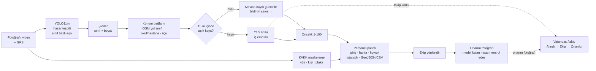

# Bursa Yol Hasarı Karar Destek Sistemi (PoC)

Saha araçlarından ve vatandaşlardan gelen yol fotoğraflarını **önceliklendirilmiş, CBS uyumlu iş emirlerine** dönüştüren, onarımı fotoğrafla kapatan ve vatandaşa takip imkânı veren uçtan uca bir prototip.

**Canlı demo:** [yolhasari.tech](https://yolhasari.tech) (personel paneli, giriş gerekir) · Vatandaş: [yolhasari.tech/bildir](https://yolhasari.tech/bildir), [yolhasari.tech/takip](https://yolhasari.tech/takip)



**İki kapı:** Vatandaş giriş yapmadan fotoğraf gönderir (`/bildir`) ve kendisine verilen kodla bildirimini izler (`/takip`). Harita, kayıtlar, fotoğraflar, durum değişiklikleri, istatistik ve dışa aktarma yalnızca giriş yapmış belediye personeline açıktır.

## Neler yapıyor?

| Katman | Ne yapıyor | Dosya |
|---|---|---|
| Hasar tespiti | RDD2022 + Türkiye görüntüleriyle eğitilmiş YOLO11m: boyuna çatlak (D00), enine çatlak (D10), timsah sırtı (D20), çukur (D40); her sınıf için ayrı güven eşiği; dikey fotoğraflarda yol bölgesi ayrıca yüksek çözünürlükte taranır | `app/detector.py` |
| Şiddet ve öncelik | Hasarın kendisi (şiddet) ile ekibin önce nereye gideceği (öncelik) ayrı hesaplanır | `app/severity.py` |
| Konum bağlamı | Hasar ana arterde mi, ara sokakta mı? 150 m içinde okul/hastane var mı? (OpenStreetMap, çevrimdışı) | `app/context.py` |
| KVKK | Kişi, yüz ve plaka bölgeleri **diske yazılmadan önce** maskelenir; ham görüntü saklanmaz; saklama süresi dolan görseller silinir | `app/privacy.py` |
| Mükerrer kayıt | 15 m içindeki açık kayıtla birleştirir, yeni iş emri açmaz; konum her bildirimle ortalanır | `app/pipeline.py`, `app/repository.py` |
| İş emri | Her arızaya iş emri numarası (YH-yıl-sıra); 70 ve üzeri puan kritik olarak iş kuyruğunun başına alınır | `app/repository.py` |
| Video | Saha aracı videosunda ByteTrack takibi: her hasar bir kez gönderilir, GPS zamanla eşlenir | `scripts/process_video.py` |
| Arayüz | Leaflet haritası, fotoğraf yükleme, önceliğe göre iş kuyruğu, saha geri bildirimi, ayrıntılı analiz raporu | `app/static/index.html` |
| Mobil bildirim | `/bildir`: telefon kamerası, zorunlu GPS konumu (doğruluk gösterilir), KVKK onayı, gönderim öncesi küçültme; sonuçta takip kodu. "Saha ekibi" seçeneği yalnızca giriş yapmış personele görünür | `app/static/bildir.html` |
| Canlı panel | Yeni bildirimler ve durum değişiklikleri panele anında düşer (Server-Sent Events); bildirim kartı, takip modu, QR kod | `app/events.py` |
| Yönetici girişi | Panel, arıza listesi, görseller ve durum değişiklikleri yalnızca belediye personeline açık; vatandaş bildirimi ve takibi girişsiz. İmzalı oturum çerezi (HttpOnly, SameSite=Strict), PBKDF2 şifre özeti, giriş deneme sınırı, durum değişikliğinde "kim, ne zaman" kaydı | `app/auth.py` |
| Vatandaş takibi | Bildirene özel takip kodu (ör. `K7M2-Q9XD`); `/takip` sayfasında Alındı → Ekip yönlendirildi → Onarıldı adımları ve onarım sonrası fotoğrafı. İş emri numarası sıralı olduğu için takipte kullanılmaz (başkasının kaydı tahmin edilemesin) | `app/static/takip.html` |
| Onarım kanıtı | "Onarıldı" fotoğrafla kaydedilir: fotoğraf maskelenip saklanır, model hasar kalıp kalmadığını kontrol eder, konum kayıttan 50 m'den uzaksa uyarır; panelde önce/sonra yan yana | `app/pipeline.py` |
| Kayıt yönetimi | Haritadaki kayıtta **Yönet**: ekibe atama (ekip listesi `TEAMS`), hasar türünü düzeltme (öncelik yeniden hesaplanır), not ekleme, kaydın geçmişi; fotoğraflarıyla kalıcı silme (gerekçe ve iki adımlı onay). Başlıktaki **İşlem geçmişi**: tüm sistemde kim, ne zaman, ne yaptı; silinen kayıtların izi dahil | `app/static/index.html`, `app/repository.py` |
| Sahadan eğitime | Yöneticinin hasar türü düzeltmesi, “Yanlış tespit” (hasarsız örnek) ve onarım (doğrulanmış tespit) kararları kendiliğinden eğitim örneği olur. **Eğitim verisi** ekranında yönetici örnekleri görür (kırmızı: model, yeşil: etiket), onaylar ya da hariç tutar; saha doğrulaması (model kaç kayıtta doğru bildi) burada görünür. Onaylananlar YOLO formatında `saha_egitim_*.zip` olarak iner; Drive'a konunca 03 notebook'u eğitime ekler. Colab'ın sürekli açık olması gerekmez | `app/training.py` |
| Filtre, istatistik, dışa aktarma | İlçe (OpenStreetMap ilçe sınırları), hasar türü ve durum filtresi; günlük bildirim/onarım grafiği, ortalama ekip yönlendirme ve onarım süresi; filtrelenmiş kayıtları GeoJSON (Netcad, ArcGIS, QGIS) ve CSV (Excel) indirme | `app/repository.py`, `app/export.py` |

## Model sonuçları

İki model aynı veri bölümleriyle eğitildi (RDD2022'nin 5 ülkesi: 17.818 eğitim, 2.225 doğrulama görüntüsü) ve modellerin **hiç görmediği** aynı 2.232 test görüntüsünde (4.030 hasar) ölçüldü.

- **v1:** YOLO11s, 640 px ([01_model_egitimi_colab.ipynb](notebooks/01_model_egitimi_colab.ipynb))
- **v2 (uygulamada):** YOLO11m, 800 px; eğitim bölümüne Türkiye'nin 20 ilinden (25 bölge) 598 sağlam yol görüntüsü eklendi (Mapillary, yarı otomatik etiket; Bursa hariç) ([03_model_v2_gece_egitimi.ipynb](notebooks/03_model_v2_gece_egitimi.ipynb), [turkiye_veri_hazirla.py](scripts/turkiye_veri_hazirla.py))

| AP50 | v1 | v2 |
|---|---|---|
| D00 Boyuna çatlak | 0.673 | 0.716 |
| D10 Enine çatlak | 0.617 | 0.659 |
| D20 Timsah sırtı | 0.697 | 0.719 |
| D40 Çukur | 0.498 | 0.555 |
| **mAP50** | **0.621** | **0.663** |
| mAP50-95 | 0.316 | 0.338 |
| Precision / Recall | 0.622 / 0.578 | 0.656 / 0.615 |
| Çıkarım (NVIDIA L4) | 4.4 ms | 17.8 ms |
| Fotoğraf başına, dizüstü CPU | ~0.13 sn | ~0.5 sn |

Uygulama her sınıf için ayrı güven eşiği kullanır: doğrulama setinde F1'i en yüksek yapan değer (`models/esikler.json`; v2: D00 0.26, D10 0.31, D20 0.29, D40 0.36). Görüntü boyutu model dosyasından okunur. v1'e dönmek için:

```bash
MODEL_PATH=models/best_v1.pt THRESHOLDS_PATH=models/esikler_v1.json uvicorn app.main:app
```

En zayıf sınıf hâlâ çukur (D40): eğitim verisindeki en az örnekli sınıf ve uzaktan küçük görünüyor. Videoda bir çukur onlarca karede göründüğü için tek kare recall değerinin pratikteki etkisi daha düşüktür.

### Bursa testi

Mapillary'deki Bursa görüntülerinden 54'ü elle, çokgen çizilerek etiketlendi (17 hasarlı, 37 sağlam, 32 hasar).

| Bursa testi | v1, eşik 0.35 | v1, sınıf eşikleri | v2, eşik 0.35 | **v2, sınıf eşikleri** |
|---|---|---|---|---|
| mAP50 | 0.302 | 0.302 | 0.327 | **0.327** |
| Precision | 0.238 | 0.238 | 0.590 | **0.590** |
| Sağlam yolda yanlış alarm (görüntü) | 3 / 37 | 5 / 37 | 0 / 37 | **0 / 37** |
| Hasarlı yolda hasarı doğru yerde bulma (görüntü) | 8 / 17 | 10 / 17 | 7 / 17 | **9 / 17** |

Başka ülkelerin verisiyle eğitilen v1 Bursa'da yarı performansa düşüyordu (alan farkı). Gözlenen hatalar: şerit çizgisi → boyuna çatlak, rögar kapağı → çukur, parke taşı → timsah sırtı, aşınmış asfalttaki çatlakları kaçırma. v2'de sağlam yollardaki yanlış alarmlar kayboldu ve kesinlik 0.24'ten 0.59'a çıktı; kaçırma ise büyük ölçüde sürüyor. Türkiye verisine yalnızca sağlam yol örnekleri girdiği için bu beklenen bir sonuç. Model boyutu ve Türkiye verisi birlikte değiştiği için etkileri ayrıca ölçülmedi. Örneklem küçük olduğu için sınıf bazında sonuç verilmemiştir.

## Öncelik formülü

```
Şiddet  S = max_i [ w_sınıf × (0.5 + 0.5 × boyut) ] + çoklu hasar katkısı (≤ 0.15)     0–1
Öncelik P = 100 × S × K_konum × B_bildirim                                              1–100

w_sınıf   : D40 1.0 · D20 0.8 · D10 0.5 · D00 0.4      (Fen İşleri ayarlayabilir: CLASS_WEIGHTS)
boyut     : çatlaklarda (D00, D10) uzunluk, timsah sırtı ve çukurda (D20, D40) alan;
            kalibre araç kamerasında metre / m² (homografi), diğerlerinde görüntüye oranla
K_konum   : otoyol/devlet yolu 1.0 · ana arter 0.9 · tali 0.8 · toplayıcı 0.7 · ara sokak 0.55, okul/hastane yakını +0.1
B_bildirim: 1 + 0.25 × ln(bildirim sayısı)
```

Model güven skoru şiddete **katılmaz**; yalnızca eşik olarak kullanılır (sınıf bazlı eşikler `models/esikler.json`, dosya yoksa tüm sınıflar için `CONF_THRESHOLD`). Güven, modelin ne kadar emin olduğunu gösterir, hasarın ne kadar kötü olduğunu değil. Eşiğin altında kalan tespitler kayıt açmaz, analiz raporunda "zayıf aday" olarak gösterilir.

| Seviye | Puan | Önerilen aksiyon (Fen İşleri belirler) |
|---|---|---|
| Kritik | ≥ 70 | Kuyruğun başı, ilk müsait ekip |
| Yüksek | 45–69 | Haftalık plan |
| Orta | 25–44 | İzleme |
| Düşük | < 25 | Periyodik bakım |

## Hızlı başlangıç

### 1. Modeli eğitin (Google Colab)

Colab'da **Dosya → Not defteri aç → GitHub** sekmesinden bu repoyu açın.

1. **v1:** [`notebooks/01_model_egitimi_colab.ipynb`](notebooks/01_model_egitimi_colab.ipynb), T4 GPU. Önce `QUICK=True` ile deneyin, sonra tam eğitimi başlatın. Sonuç Drive'da `yol-hasar-tespit/best.pt`. Sunum grafiklerini de üretir: sınıf dağılımı, eğitim eğrileri, karışıklık matrisi, test metrikleri, hata analizi, örnek tahminler.
2. **v2 (uygulamadaki model):** [`notebooks/03_model_v2_gece_egitimi.ipynb`](notebooks/03_model_v2_gece_egitimi.ipynb), L4 GPU, "Tümünü çalıştır" (gece boyu, kesilirse kaldığı yerden devam eder).
   - Türkiye verisi isteğe bağlıdır: `python scripts/turkiye_veri_hazirla.py` (Mapillary token gerekir) ile üretilen `data/turkiye_egitim.zip` dosyasını Drive'daki `yol-hasar-tespit` klasörüne yükleyin.
   - Notebook v1 ile v2'yi aynı test setinde kıyaslar ve sınıf bazlı eşikleri doğrulama setinde hesaplar.
3. Drive'daki `yol-hasar-tespit/v2/` klasöründen `best_v2.pt` dosyasını `models/best.pt`, `esikler_v2.json` dosyasını `models/esikler.json` olarak koyun.

### 2. Docker ile çalıştırın

`models/best.pt` dosyası yerindeyken:

```bash
cp .env.example .env      # ADMIN_PASSWORD ve SECRET_KEY değerlerini doldurun
docker compose up --build
```

Arayüz: http://localhost:8000 (personel girişi: kullanıcı `yonetici`, şifre `.env` içindeki `ADMIN_PASSWORD`) · Vatandaş: http://localhost:8000/bildir, http://localhost:8000/takip · API dokümantasyonu: http://localhost:8000/docs

`ADMIN_PASSWORD` boş bırakılırsa giriş kapalıdır ve panel herkese açılır: bu yalnızca yerel geliştirme içindir, uygulama açılışta uyarı yazar. Yayın kurulumunda (`deploy/`) şifre zorunludur.

- İlk derleme ~3,5 dakika sürer; imaj ~2,6 GB'tır (CPU sürümü PyTorch). Sonraki açılışlar birkaç saniyedir.
- KVKK maskeleme modelleri (yüz, kişi/araç) imaja gömülüdür; çalışırken internet gerekmez. Yalnızca harita karoları internetten gelir.
- Hasar modeli imaja girmez, `models/` klasöründen bağlanır: yeni model için imajı yeniden derlemek gerekmez.
- Veritabanı ve maskelenmiş görseller `yol_hasar_data` biriminde (volume) tutulur; konteyner yeniden başlasa da korunur.
- 8000 portu doluysa: `PORT=8001 docker compose up`
- Docker Desktop + WSL2 üzerinde test edildi: sağlık kontrolü, uçtan uca demo akışı (tarayıcı testi) ve yeniden başlatmada veri kalıcılığı.

### İnternette yayınlama (HTTPS)

Türkiye'deki bir sunucuda kalıcı HTTPS adresiyle yayınlama: [docs/yayinlama.md](docs/yayinlama.md). Uygulama ve otomatik HTTPS (Caddy, Let's Encrypt) `deploy/docker-compose.prod.yml` ile birlikte kalkar; kurulum `deploy/sunucu_kurulum.sh` ile tek komuttur. Yayında etiket aracı kapalıdır ve IP başına istek sınırı uygulanır.

### 3. Docker olmadan (geliştirme)

```bash
python -m venv .venv && source .venv/bin/activate
pip install -r requirements-dev.txt
python scripts/download_models.py
cp .env.example .env      # yerelde de okunur: ADMIN_PASSWORD, SECRET_KEY
uvicorn app.main:app --reload
pytest                    # 100 test: analiz hattı, API, giriş, takip, onarım, kayıt yönetimi, dışa aktarma
```

Birden çok personel hesabı: `ADMIN_USERS=ali:sifre1,veli:sifre2`. Şifre yerine özet yazmak için `python -m app.auth` (özeti tek tırnak içine alın).

## API

| Uç nokta | Açıklama |
|---|---|
| **Herkese açık** | |
| `POST /api/analyze-road` | `image` (dosya), `lat`, `lon` (boşsa EXIF GPS), `source` (`vatandas`; `saha_ekibi` ve `saha_araci` giriş ister). Yanıtta bildirene özel `takip_kodu` |
| | Yanıtta analiz raporu: karar ve gerekçesi (`degerlendirme`), eşik altı zayıf adaylar, konum bağlamı (yol sınıfı, yakın okul/hastane, veri kapsamı), görüntü kalitesi (yön, ışık), analiz süresi ve işaretlenmiş önizleme. Dikey fotoğraflarda yol bölgesi ayrıca yüksek çözünürlükte taranır. |
| `GET /api/takip/{kod}` | Vatandaş takibi: durum adımları, onarım fotoğrafı bağlantısı (IP başına dakikada 30 sorgu) |
| `GET /bildir`, `GET /takip` | Mobil bildirim sayfası (telefon kamerası + GPS), takip sayfası |
| `GET /health` | Model, KVKK dedektörleri, bağlam verisi, giriş durumu |
| `POST /api/giris`, `POST /api/cikis`, `GET /api/oturum` | Personel oturumu (`{"kullanici", "sifre"}`) |
| **Personele özel (giriş gerekli)** | |
| `GET /api/issues?durum=acik,ekip_yonlendirildi&sinif=D40&ilce=Nilüfer&ekip=Ekip 2&min_oncelik=45` | Arızalar, GeoJSON `FeatureCollection` (EPSG:4326), önceliğe göre sıralı |
| `GET /api/issues/{id}` | Arıza, tüm bildirimleri ve durum geçmişi (kim, ne zaman) |
| `PATCH /api/issues/{id}` | `{"durum": "ekip_yonlendirildi" \| "onarildi" \| "yanlis_tespit" \| "acik", "aciklama": "...", "ekip": "Ekip 2"}` |
| `POST /api/issues/{id}/not` | `{"metin": "..."}`: kayda not |
| `POST /api/issues/{id}/sinif` | `{"sinif": "D00"}`: hasar türünü düzelt, öncelik yeniden hesaplanır |
| `DELETE /api/issues/{id}` | `{"gerekce": "..."}`: kaydı fotoğraflarıyla kalıcı sil (iz işlem geçmişinde kalır) |
| `GET /api/gecmis?limit=100` | Son işlemler: kim, ne zaman, hangi kayıtta ne yaptı |
| `GET /api/ayarlar` | Ekip listesi ve hasar sınıfları |
| `GET /api/egitim?durum=bekliyor` | Eğitim örnekleri ve saha doğrulaması |
| `POST /api/egitim/{id}` | `{"durum": "onaylandi" \| "haric" \| "bekliyor"}`: değerlendirme |
| `GET /api/egitim-paketi` | Onaylı örnekler, YOLO formatında zip |
| `POST /api/issues/{id}/onarim` | Onarım fotoğrafı (`image`, isteğe bağlı `lat`, `lon`): kaydı kapatır, hasar kalıp kalmadığını kontrol eder |
| `GET /api/istatistik?gun=30&ilce=...&sinif=...` | Günlük bildirim/onarım, durum, sınıf ve ilçe dağılımı, ortalama ekip yönlendirme ve onarım süresi |
| `GET /api/disa-aktar?bicim=geojson\|csv&...` | Filtrelenmiş kayıtları indir (CSV: Türkçe Excel için noktalı virgül ve UTF-8 BOM) |
| `GET /api/stats`, `GET /api/ilceler` | Üst çubuk özetleri, ilçe listesi |
| `GET /api/olaylar` | Gerçek zamanlı olay akışı (SSE): `bildirim`, `durum` |
| `GET /media/{dosya}` | Maskelenmiş tespit ve onarım görselleri |
| `GET /etiket` | Yerel etiket düzeltme aracı (yayında kapalı) |

GeoJSON çıktısı Netcad, ArcGIS ve QGIS'e doğrudan katman olarak eklenebilir.

## Veri

| Veri | Kaynak | Lisans | Kullanım |
|---|---|---|---|
| RDD2022 (Çekya, Hindistan, Japonya, ABD, Çin) | [figshare](https://figshare.com/articles/dataset/21431547), Arya ve ark. 2022 | CC BY 4.0 | Eğitim / doğrulama / test |
| Bursa sokak görüntüleri | [Mapillary](https://www.mapillary.com), `scripts/fetch_mapillary_bursa.py` | CC BY-SA 4.0 | Bursa test seti (alan farkı ölçümü) |
| Bursa yol ağı, okul, hastane | OpenStreetMap, `scripts/fetch_osm_context.py` | ODbL | Konum katsayısı |
| Bursa ilçe sınırları (17 ilçe) | OpenStreetMap, `scripts/fetch_osm_districts.py` | ODbL | İlçe filtresi ve istatistik |
| Türkiye sokak görüntüleri (20 il, 25 bölge; Bursa hariç) | [Mapillary](https://www.mapillary.com), `scripts/turkiye_veri_hazirla.py` | CC BY-SA 4.0 | v2 eğitimine 598 sağlam yol örneği (yarı otomatik etiket) |

**RDD2022'de Türkiye verisi yoktur.** Bu nedenle v2 eğitimine Türkiye görüntüleri eklendi ve model ayrıca, eğitimde hiç kullanılmayan Bursa görüntülerinden oluşan bir test setinde ölçülür.

### Bursa test seti oluşturma

```bash
export MAPILLARY_TOKEN="MLY|..."          # https://www.mapillary.com/dashboard/developers
python scripts/fetch_mapillary_bursa.py --per-cell 15
python scripts/fetch_mapillary_bursa.py --candidates --since "" --out data/bursa_test/aday   # yıpranmış yol adayları
```

1. Görüntüleri ve modelin ön-etiketlerini `data/bursa_test/etiket/` klasörüne koyun (`<ad>.jpg` + `<ad>.txt`, YOLO formatı; ilk tahminlerin yedeği `_model/` altında).
2. **http://localhost:8000/etiket** sayfasında her görüntüyü kontrol edin: yanlış kutuyu silin, eksik hasarı çizin, sınıfı düzeltin. Görüntüler bilgisayardan çıkmaz.
3. Ölçün:

```bash
python scripts/evaluate_bursa.py                                                         # uygulamadaki model (v2)
python scripts/evaluate_bursa.py --model models/best_v1.pt --thresholds models/esikler_v1.json  # v1 ile kıyas
```

Çıktı, RDD2022 test sonucuyla kıyaslamanın yanında iki görüntü düzeyi metrik verir: sağlam yolda yanlış alarm oranı ve hasarlı yolda yakalama oranı.

## Telefondan canlı bildirim

`/bildir` sayfası telefonda kamerayı açar, GPS konumu alınmadan ve KVKK onayı verilmeden gönderime izin vermez. Bildirim analiz edilir ve panele anında düşer (ölçülen uçtan uca süre ~2-3 sn). Hasar bulunduysa vatandaşa bir takip kodu gösterilir ve cihazda saklanır; `/takip` sayfasında durum adımlarını ve onarım sonrası fotoğrafını görür.

Telefon tarayıcıları kamera ve konum iznini yalnızca **HTTPS** adreslerde verir. Yerel ağdaki `http://192.168...` adresi bu yüzden çalışmaz. Demo için bilgisayardaki uygulamaya geçici bir HTTPS tüneli açılır ve adresi `PUBLIC_URL` olarak verilir; paneldeki **Telefonla bildir** QR kodu bu adresi gösterir. Tünel açıkken uygulama internetten erişilebilirdir: yalnızca demo süresince açık tutun.

## Saha aracı videosu

```bash
python scripts/process_video.py --video tur.mp4 --gps tur.gpx --video-start 2026-10-26T09:15:00Z
```

## Sınırlılıklar ve yol haritası

- **Alan farkı ve kaçırma:** v2 Bursa'da sağlam yollarda yanlış alarm vermiyor ama hasarlı yolların yaklaşık yarısında hasarı kaçırıyor. Türkiye verisine şimdilik yalnızca sağlam yol örnekleri girdi; Türk yollarından hasarlı örneklerin etiketlenmesi ve pilotta saha ekibince doğrulanan (`yanlis_tespit`, onarım fotoğrafları) görüntülerle yeniden eğitim planlanmıştır. Bursa test seti küçüktür (54 görüntü).
- **Kimlik doğrulama:** PoC'ta personel hesapları ortam değişkeniyle tanımlanır ve tek rol vardır. Üretimde belediyenin kullanıcı dizinine (ör. Active Directory / SSO) bağlanma ve rol ayrımı (müdürlük, saha ekibi) önerilir.
- **Boyut tahmini:** Vatandaş fotoğraflarında kamera açısı bilinmediği için boyut yaklaşıktır. Kalibre edilmiş araç kamerasında homografi ile m² hesaplanır.
- **KVKK dedektörleri:** Varsayılan kurulum yüzleri (YuNet) ve kişileri tamamen, araçların plaka bölgesini temkinli biçimde maskeler. Üretimde Türk plakalarıyla eğitilmiş özel bir model önerilir (`PRIVACY_MODEL_PATH`).
- **Veritabanı:** PoC'ta SQLite kullanılır. Üretimde PostGIS (`ST_DWithin` + GiST indeksi) ve belediyenin CBS altyapısıyla entegrasyon önerilir.
- **Gece/yağmur:** Eğitim verisi ağırlıklı olarak gündüz görüntülerinden oluşur; bu koşullardaki performans ayrıca ölçülmelidir.

## Proje yapısı

```
app/            FastAPI servisi: analiz hattı, skor, KVKK, konum bağlamı, giriş (auth.py), dışa aktarma
app/static/     arayüz: panel (index), giriş, mobil bildirim (bildir), vatandaş takibi (takip), etiket aracı
scripts/        RDD2022 indirme/dönüştürme, Mapillary (Bursa, Türkiye), OSM (yollar, ilçeler), Bursa değerlendirme, video
notebooks/      Colab: 01 v1 eğitimi, 03 v2 gece eğitimi ve v1/v2 kıyası
tests/          birim, API ve güvenlik testleri (pytest)
deploy/         yayın kurulumu: Caddy (otomatik HTTPS), docker-compose.prod.yml, sunucu_kurulum.sh
docs/           sunum notları, demo senaryosu, yayınlama rehberi
data/           OSM yol ağı ve ilçe sınırları (çalışma zamanı verisi repoya girmez)
models/         model ağırlıkları ve eşik dosyaları (repoya girmez)
```
